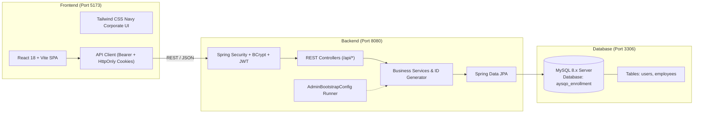

# Aysqo Technologies — Employee Enrollment System

[](https://www.oracle.com/java/)
[](https://spring.io/projects/spring-boot)
[](https://react.dev/)
[](https://tailwindcss.com/)
[](https://www.mysql.com/)
[](#)

A production-grade, enterprise Employee Enrollment and Human Resources Management System designed and built for **Aysqo Technologies**. The solution features a modern, responsive corporate dashboard, server-side paginated employee directory with multi-field search and filters, dynamic unique Employee ID generation (`AYS-YYYY-XXXX`), enrollment lifecycle tracking (Draft, Submitted, Approved), role-based access control (`ADMIN` and `HR`), BCrypt password hashing, and persistent MySQL 8.x integration.

---

## 1. System Architecture



---

## 2. Monorepo Directory Structure

```text
aysqo-employee-enrollment/
├── frontend/
│   ├── src/
│   │   ├── components/
│   │   │   ├── layout/       # Sidebar, Navbar, AppLayout, ProtectedRoute
│   │   │   └── ui/           # StatCard, StatusBadge, Pagination, ConfirmModal, Toast
│   │   ├── context/          # AuthContext (state, tokens, session management)
│   │   ├── pages/            # 9 Required Pages (Login, Dashboard, Directory, Add, Details, Edit, Inactive, Profile, 404)
│   │   ├── services/         # Axios API wrappers (auth, employee, dashboard)
│   │   ├── App.jsx           # Application routing configuration
│   │   ├── main.jsx          # React DOM entrypoint
│   │   └── index.css         # Tailwind directives and corporate scrollbars
│   ├── public/               # Static assets
│   ├── .env.example          # Frontend environment variables template
│   ├── package.json          # Vite + React + Tailwind dependencies
│   ├── tailwind.config.js    # Corporate navy/slate theme extension
│   └── vite.config.js        # Vite dev server + proxy configuration
├── backend/
│   ├── src/main/java/com/aysqo/enrollment/
│   │   ├── config/           # SecurityConfig, CorsConfig, AdminBootstrapConfig
│   │   ├── controller/       # AuthController, EmployeeController, DashboardController
│   │   ├── dto/              # API request/response transfer objects
│   │   ├── entity/           # JPA entities (User, Employee, Enums)
│   │   ├── exception/        # Global exception handling & standard responses
│   │   ├── repository/       # Spring Data JPA repositories with Specifications
│   │   ├── security/         # JWT provider, UserPrincipal, CustomUserDetailsService
│   │   ├── service/          # Business logic, ID generator, dashboard metrics
│   │   └── AysqoEnrollmentApplication.java
│   ├── src/main/resources/
│   │   ├── application.yml         # Base configuration & actuator
│   │   └── application-mysql.yml   # MySQL datasource configuration
│   ├── src/test/java/com/aysqo/enrollment/
│   │   ├── AuthAndSecurityTests.java       # 6 unit/integration security tests
│   │   └── EmployeeAndDashboardTests.java  # 9 CRUD, validation, and metrics tests
│   ├── src/test/resources/
│   │   └── application-test.yml    # H2 in-memory profile for test automation
│   ├── .env.example          # Backend environment variables template
│   └── pom.xml               # Maven project object model
├── database/
│   ├── schema.sql            # Repeatable DDL schema (users, employees tables)
│   └── seed.sql              # Synthetic demonstration employees & users
├── docs/
│   ├── API.md                # Comprehensive REST API endpoint reference
│   ├── TESTING.md            # Test suites, automation results, verification
│   └── DEMO.md               # Scripted presentation walkthrough
├── .gitignore                # Production ignore rules (excludes credentials & node_modules)
└── README.md                 # Master project documentation
```

---

## 3. Prerequisites & Development Tools

Verify the installed tools on your Windows PC:

| Tool | Recommended Version | Verification Command | Status on PC |
| :--- | :--- | :--- | :--- |
| **Java JDK** | 17+ (or Oracle JDK 26) | `java -version` | Installed (`26.0.1`) |
| **Maven** | 3.9+ | `mvn -v` | Installed (`3.9.16`) |
| **Node.js** | 18+ (or 20+) | `node -v` | Installed (`v26.9.0`) |
| **npm** | 9+ | `npm -v` | Installed (`11.19.1`) |
| **MySQL Server** | 8.0.x | `mysql --version` | Installed (`8.0.46`, Service `MySQL80`) |
| **MySQL Workbench** | 8.0.x | GUI Client | Installed |
| **Git** | 2.x | `git --version` | Installed (`2.56.0`) |

---

## 4. MySQL Database Setup via MySQL Workbench

MySQL Server is installed and running on your system as the Windows Service `MySQL80`. Follow these exact steps to configure the database in MySQL Workbench:

### Step 1: Open MySQL Workbench
1. Press `Windows Key`, type **MySQL Workbench**, and launch the application.
2. Under **MySQL Connections**, click **Local instance MySQL80** (Host: `127.0.0.1`, Port: `3306`).
3. Enter your MySQL `root` password when prompted.

### Step 2: Open and Execute the Schema Script
1. In MySQL Workbench, click **File** -> **Open SQL Script...** (or press `Ctrl + Shift + O`).
2. Navigate to:
   ```text
   C:\Users\admin\aysqo-employee-enrollment\database\schema.sql
   ```
3. Click the **Execute (Lightning Bolt)** icon or press `Ctrl + Shift + Enter`.
4. In the **SCHEMAS** tab on the left panel, right-click and choose **Refresh All**. You will see the new schema `aysqo_enrollment` containing `users` and `employees` tables.

### Step 3: (Optional) Execute Seed Script
1. In Workbench, open:
   ```text
   C:\Users\admin\aysqo-employee-enrollment\database\seed.sql
   ```
2. Click **Execute** (`Ctrl + Shift + Enter`).
> **Note:** Even if you do not run `seed.sql`, the Spring Boot application includes an automatic `AdminBootstrapConfig` runner that safely populates initial admin, HR, and synthetic records upon startup if the database is empty!

### Step 4: Verify Database Tables in Workbench
Run this query in a Workbench query tab:
```sql
USE aysqo_enrollment;
SELECT COUNT(*) AS total_users FROM users;
SELECT COUNT(*) AS total_employees FROM employees;
```

---

## 5. Running the Application Locally (Step-by-Step)

Open Visual Studio Code in the project root:
```powershell
code C:\Users\admin\aysqo-employee-enrollment
```

### Terminal 1: Start the Spring Boot Backend

1. Open a new PowerShell terminal in VS Code (`Ctrl + ~`).
2. Set your MySQL root password into the environment variable (or match your local root password):
   ```powershell
   $env:DB_PASSWORD="your_mysql_root_password"
   ```
3. Navigate to the backend directory and run:
   ```powershell
   cd C:\Users\admin\aysqo-employee-enrollment\backend
   mvn spring-boot:run
   ```
4. Verify backend health in your browser:
   - **URL:** [http://localhost:8080/actuator/health](http://localhost:8080/actuator/health)
   - **Expected Output:** `{"status":"UP"}`

### Terminal 2: Start the React + Vite Frontend

1. Open a second PowerShell terminal in VS Code (`Ctrl + Shift + 5` or click `+`).
2. Navigate to the frontend directory and launch the development server:
   ```powershell
   cd C:\Users\admin\aysqo-employee-enrollment\frontend
   npm run dev
   ```
3. Open your browser to:
   - **URL:** [http://localhost:5173](http://localhost:5173)

---

## 6. Demonstration Accounts (Safe Local Bootstrap)

The application features a secure, local bootstrap mechanism (`AdminBootstrapConfig.java`). If no administrator exists in the database, it automatically creates the authorized demonstration accounts with BCrypt-hashed passwords:

| Role | Username | Work Email | Password | Permissions |
| :--- | :--- | :--- | :--- | :--- |
| **System Administrator** | `admin` | `admin@aysqo.com` | `Admin@123` | Full access, user management, employee CRUD, deletion |
| **HR Operations Lead** | `hr_manager` | `hr@aysqo.com` | `Hr@123` | Employee enrollment, directory search, status lifecycle |

> **Pro Tip:** On the login page, click the **"Fill Admin"** or **"Fill HR Lead"** button to instantly populate demonstration credentials!

---

## 7. Running Automated Tests

Run the full automated test suite (15 unit and integration tests):

```powershell
cd C:\Users\admin\aysqo-employee-enrollment\backend
mvn clean test
```

### Verified Test Summary
- **Total Tests Run:** 15
- **Failures:** 0
- **Errors:** 0
- **Execution Time:** ~11 seconds

---

## 8. Building Production Artifacts

### Frontend Production Build
```powershell
cd C:\Users\admin\aysqo-employee-enrollment\frontend
npm run build
```
Generates optimized static assets in `frontend/dist/`.

### Backend Production Build
```powershell
cd C:\Users\admin\aysqo-employee-enrollment\backend
mvn clean package -DskipTests
```
Generates runnable executable JAR in `backend/target/aysqo-employee-enrollment-backend-1.0.0.jar`.

---

## 9. Cloud Deployment Feasibility & Pricing Analysis

If presenting to company representatives regarding future cloud deployment:

| Layer | Provider | Feasibility | Pricing Tier (Current 2026 Plans) | Notes |
| :--- | :--- | :--- | :--- | :--- |
| **Frontend** | **Vercel** | **Highly Feasible** | Hobby Tier: **Free** ($0/month) | Native support for Vite/React SPA. Connect Git repository, set build command `npm run build`, output directory `dist`. Set `VITE_API_BASE_URL` to backend URL. |
| **Backend** | **Render / Railway / AWS Elastic Beanstalk** | **Feasible** | Render Free Web Service ($0) or Railway Hobby ($5/mo) | Free web services spin down after 15 min of inactivity. For continuous uptime, $5–$7/mo tier is recommended. |
| **Database** | **Aiven / Railway / PlanetScale / AWS RDS** | **Feasible** | Aiven MySQL Free tier (limited) or Railway MySQL ($5/mo) | Managed MySQL 8.x with automated backups and SSL encryption. |

---

## 10. Troubleshooting Common Issues

1. **MySQL `Access denied for user 'root'@'localhost'`**:
   - Provide your local root password by setting the `$env:DB_PASSWORD` variable before running `mvn spring-boot:run`:
     ```powershell
     $env:DB_PASSWORD="your_actual_password"
     ```
2. **Port 8080 or 5173 already in use**:
   - Check listening ports in PowerShell:
     ```powershell
     Get-NetTCPConnection -LocalPort 8080 -ErrorAction SilentlyContinue
     Get-NetTCPConnection -LocalPort 5173 -ErrorAction SilentlyContinue
     ```
   - Kill the lingering process if needed:
     ```powershell
     Stop-Process -Id <PID> -Force
     ```
3. **CORS Errors**:
   - The backend allows `http://localhost:5173` and `http://127.0.0.1:5173` by default. If running frontend on another port, adjust `app.cors.allowed-origins` in `backend/src/main/resources/application.yml`.

---

## 11. Project Summary & Compliance

- [x] **Monorepo Structure:** Created `aysqo-employee-enrollment` with `frontend/`, `backend/`, `database/`, `docs/`.
- [x] **Frontend:** React 18, Vite, Tailwind CSS, JavaScript (no TypeScript).
- [x] **Backend:** Java 17/26, Spring Boot 3.3.5, Spring Security, BCrypt, JWT, Maven.
- [x] **Database:** MySQL 8.x, InnoDB, utf8mb4 charset, schema and synthetic seed data.
- [x] **Zero Hardcoded Data:** All 9 UI pages connected to persistent REST APIs.
- [x] **Automated Tests:** 15 passing tests covering authentication, hashing, duplicate prevention, and CRUD.
- [x] **Documentation:** Complete `API.md`, `TESTING.md`, `DEMO.md`, and `README.md`.
